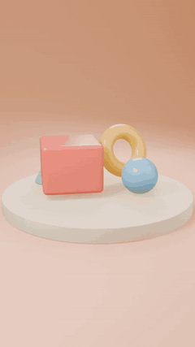
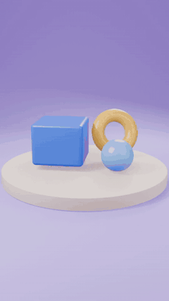
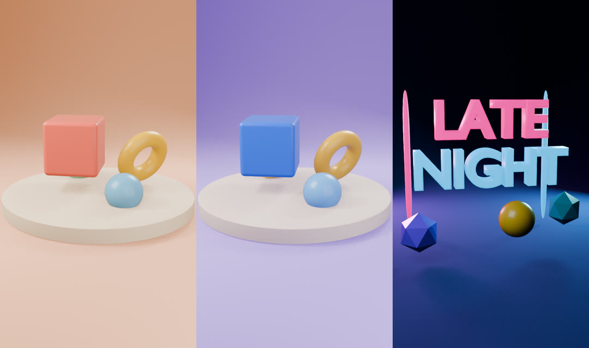
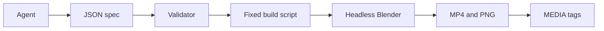

# dioramic for Hermes

**Describe a scene in chat, and Hermes renders a vertical 3D clip in Blender.**

<p align="center">
  
  
</p>

<p align="center"><i>Left: "a coral cube bouncing on a cream plinth, slow orbit". Right: "make the cube blue". Real renders on a CPU-only box.</i></p>

I make 3D Blender-style videos for TikTok. Blocking out each scene by hand is the slow part. With dioramic, you describe the scene in a Hermes chat, the agent fills in a structured spec, and headless Blender renders a 9:16 clip ready for TikTok, Reels or Shorts. Then you say "make the cube blue" and it renders a new version. The model never writes Blender code.

[Install](#install) · [Quick start](#quick-start) · [Tools](#the-two-tools) · [Scene spec](#scene-spec) · [How it works](#how-it-works) · [Safety](#safety) · [Tests](#tests)

## Install

Needs [Hermes Agent](https://github.com/NousResearch/hermes-agent) 0.23 or newer, and Blender 4.2 or newer (tested with 4.2.3 LTS, CPU only, no GPU).

```bash
hermes plugins install faze39/dioramic --enable
hermes config set plugins.entries.dioramic.settings.blender_path /path/to/blender
```

If `blender` is already on your `PATH`, or you have `BLENDER_BIN` set, you can skip the config line. The GitHub URL also works: `hermes plugins install https://github.com/faze39/dioramic --enable`.

## Quick start

In any Hermes chat (CLI, Telegram, Discord, Slack), type:

```text
make a 4 second clip of a coral cube bouncing on a cream plinth, slow orbit
```

You do not write any JSON. Hermes turns that sentence into a scene spec and calls `dioramic_render`. When the render finishes, the reply includes the video and a still preview, delivered as `MEDIA:` tags so the gateway shows them in the chat.

Then iterate:

```text
make the cube blue
```

Hermes calls `dioramic_tweak` with only the changes. The first version is kept. The new one is saved as a new scene id ending in `-v2`.

To check layout before waiting on a full clip, ask for a still first ("just a preview of that scene"). Hermes will set `preview_only` to true, which takes a few seconds once shaders are warm instead of several minutes.

### What you get back

The tool returns JSON to the agent, and the media to you:

| Field | Meaning |
| --- | --- |
| `scene_id` | Id to pass to `dioramic_tweak` later |
| `clip` | Path to the MP4, or `null` if this was a preview-only render |
| `preview` | Path to a still PNG (a mid-clip frame) |
| `media` | `MEDIA:<path>` entries for the clip and preview, which the gateway attaches |
| `warnings` | Anything that was clamped (duration, samples, out-of-range numbers) |
| `render_seconds` | How long Blender ran |
| `frames`, `objects`, `spec` | Frame count, object ids, and a short summary of the normalised spec |
| `based_on` | On a tweak only: the scene id you started from |

If the spec is invalid, the tool does not render. It returns `{"error": "scene spec has problems", "problems": [...]}` so the agent can fix the fields and try again.

### Where the files land

Everything is written under your Hermes home, which is `$HERMES_HOME` if set, otherwise `~/.hermes`:

```text
~/.hermes/plugin-data/dioramic/scenes/<scene_id>/
  spec.json      the validated spec used for this render
  clip.mp4       the vertical H.264 clip (skipped when preview_only)
  preview.png    a still frame
  render.log     Blender's stdout
```

Scene ids are generated by the plugin from the title and a timestamp, for example `coral-bounce-1111-1927`. A tweak of that scene becomes `coral-bounce-1111-1927-v2`, then `-v3`, and so on. The agent cannot choose the path.

## The two tools

| Tool | What it does |
| --- | --- |
| `dioramic_render` | Builds a new scene from a full spec and renders an MP4 plus a still. |
| `dioramic_tweak` | Loads an earlier scene, merges only the changes, and renders a new version. The old folder is left as it is. |

### `dioramic_render`

| Parameter | Type | Required | What it is |
| --- | --- | --- | --- |
| `scene` | object | yes | The full [scene spec](#scene-spec). Must include `objects`. |
| `preview_only` | boolean | no | If true, render only the still preview. |

### `dioramic_tweak`

| Parameter | Type | Required | What it is |
| --- | --- | --- | --- |
| `scene_id` | string | yes | The `scene_id` returned by an earlier render or tweak. |
| `changes` | object | yes | Only the fields that change. Same shape as the scene spec, plus `remove_objects`. |
| `preview_only` | boolean | no | If true, render only the still preview. |

How `changes` is applied:

- Top-level fields (`background`, `lighting`, `duration`, and so on) overwrite the previous values.
- `camera` is merged field by field, so `{"camera": {"speed": 0.5}}` keeps the old move and distance.
- `objects` are matched by `id`. A known id is updated in place. An unknown id is added.
- `remove_objects` is a list of ids to drop.

Example: make the cube blue and the camera slower:

```json
{"scene_id": "coral-bounce-1111-1927", "changes": {"objects": [{"id": "hero", "color": "blue"}], "camera": {"speed": 0.5}}}
```

## Scene spec

The model never sends Blender Python. It sends JSON. Coordinates are in metres, Z is up, the floor is at z=0, and a range of about -4 to 4 fits a vertical frame. Base shapes are 2 m across, then scaled.

### Scene fields

| Field | Default | Notes |
| --- | --- | --- |
| `title` | `untitled` | Used to build the scene id. Max 60 characters. |
| `duration` | 5 s, capped by `max_duration` (default 8, hard cap 20) | Minimum 1 s. |
| `fps` | 24 | `24` or `30`. |
| `resolution` | `540x960` | `540x960`, `720x1280`, or `1080x1920`. 1080p needs `allow_hd`. |
| `samples` | 6, capped by `max_samples` (default 16, hard cap 64) | EEVEE samples per frame. |
| `background` | `cream` | Palette name or `#rrggbb`. Colours the studio sweep and the world. |
| `lighting` | `soft` | See the lighting table. |
| `camera` | orbit at distance 13, height 3 | See the camera table. |
| `objects` | required, at least one | See the object and animation tables. Max 24. |

### Shapes

| Shape | Notes |
| --- | --- |
| `cube` | |
| `sphere` | |
| `cylinder` | |
| `cone` | |
| `torus` | |
| `gem` | Faceted crystal |
| `capsule` | |
| `text` | 3D extruded letters. Set `text` (required, max 24 printable characters). |

### Object fields

| Field | Default | Notes |
| --- | --- | --- |
| `id` | required | Unique, lowercase letters, digits, `_` or `-`, max 24. Used by `dioramic_tweak`. |
| `shape` | required | One of the shapes above. |
| `text` | | Only for `shape=text`. |
| `color` | `white` | Palette name or `#rrggbb`. |
| `finish` | `toy` | See finishes. |
| `position` | `[0, 0, 0]` | `[x, y, z]` in metres. |
| `rotation` | `[0, 0, 0]` | `[x, y, z]` in degrees. |
| `scale` | `1` | A number, or `[x, y, z]`. |
| `animate` | none | A list of up to 4 animations. |

### Finishes

| Finish | Look |
| --- | --- |
| `toy` | Glossy coated plastic |
| `matte` | Soft, non-reflective |
| `metal` | Metallic |
| `glow` | Emissive, good with `night` lighting |

### Colours

Use a name from this palette, or any `#rrggbb` hex:

| Name | Hex | Name | Hex | Name | Hex | Name | Hex |
| --- | --- | --- | --- | --- | --- | --- | --- |
| `red` | `#e8453c` | `coral` | `#ff7a6b` | `orange` | `#ff9a3c` | `yellow` | `#ffd23f` |
| `lime` | `#b5e550` | `mint` | `#7fe0b5` | `green` | `#3fb873` | `teal` | `#2bb3b1` |
| `sky` | `#7cc8f5` | `blue` | `#3b7cf0` | `navy` | `#24346b` | `purple` | `#8b5cf6` |
| `lilac` | `#c4a7f5` | `pink` | `#ff8fc7` | `white` | `#f6f4ef` | `cream` | `#fbecd2` |
| `peach` | `#ffc9a8` | `grey` | `#9aa0a8` | `black` | `#22232a` | `gold` | `#e8b63c` |

### Lighting

Three-light area rigs:

| Rig | Look |
| --- | --- |
| `soft` | Even studio light: warm key, cool fill, white rim |
| `sunset` | Warm orange key, cooler fill, pink rim |
| `night` | Dim cool key, magenta and cyan rims |

### Camera

| Field | Range | Default | Notes |
| --- | --- | --- | --- |
| `move` | `orbit`, `push_in`, `pull_out`, `crane_up`, `dolly`, `static` | `orbit` | See below |
| `speed` | 0.1 to 3 | 1 | How far the move travels |
| `distance` | 3 to 30 | 13 | Metres from the target |
| `height` | -2 to 15 | 3 | Camera height in metres |
| `angle` | -180 to 180 | 25 | Start angle in degrees |
| `lens` | 18 to 135 | 40 | Focal length in mm |
| `target` | `[x, y, z]` | `[0, 0, 1]` | The look-at point |

| Move | What the camera does |
| --- | --- |
| `orbit` | Arcs around the target |
| `push_in` | Moves closer |
| `pull_out` | Moves away |
| `crane_up` | Rises |
| `dolly` | Slides sideways |
| `static` | Stays put |

### Animations

Every animation has `type`, plus optional `start` and `end` in seconds (default: the whole clip). Extra fields depend on the type:

| Type | Extra fields | What it does |
| --- | --- | --- |
| `spin` | `turns` (-6 to 6, default 1), `axis` (`x`/`y`/`z`, default `z`) | Rotates |
| `bounce` | `height` (0 to 6, default 1), `count` (0.5 to 12, default 2) | Bounces, with squash |
| `float` | `height` (default 0.3), `count` (default 1) | Gentle up and down |
| `pop_in` | `start`, `end` | Scales in from nothing |
| `move` | `to` `[x, y, z]` | Moves to a point |
| `wobble` | `degrees` (0 to 90, default 12), `count` (default 3) | Tilts back and forth |

### Limits

Out-of-range numbers are clamped and listed in `warnings`. Unknown shapes, colours, finishes, moves or animation types come back as `problems` and the render is not started.

| Limit | Value |
| --- | --- |
| Objects per scene | 24 |
| Text length | 24 printable characters |
| Animations per object | 4 |
| Coordinates | -12 to 12 metres |
| Scale | 0.05 to 6 |
| Duration | 1 s minimum; default max 8 s (user setting, hard cap 20) |
| Resolution | 1080x1920 only when `allow_hd` is on |

### JSON example

A 4 second clip that matches the prompt above. Fuller scenes, including the desk and the neon title card, are in [`examples/`](examples/).

```json
{
  "title": "coral bounce",
  "duration": 4,
  "background": "peach",
  "lighting": "soft",
  "camera": {"move": "orbit", "speed": 0.7, "distance": 14, "height": 4, "target": [0, 0, 1.1]},
  "objects": [
    {
      "id": "plinth",
      "shape": "cylinder",
      "color": "cream",
      "finish": "matte",
      "position": [0, 0, 0.25],
      "scale": [3.2, 3.2, 0.25]
    },
    {
      "id": "hero",
      "shape": "cube",
      "color": "coral",
      "position": [0, 0, 1.4],
      "scale": 0.9,
      "animate": [{"type": "bounce", "height": 1.2, "count": 2}]
    }
  ]
}
```

### Sample scenes

<p align="center">
  
</p>

| Example | Prompt it illustrates | File |
| --- | --- | --- |
| Toy desk | a coral cube bouncing on a cream plinth, with a few props, slow orbit | [`examples/toy-desk.json`](examples/toy-desk.json), [clip](docs/toy-desk.gif) |
| Same scene, tweaked | make the cube blue, lilac backdrop, slower camera | [`examples/toy-desk-tweak.json`](examples/toy-desk-tweak.json), [clip](docs/toy-desk-tweak.gif) |
| Neon title card | a late night drop, glowing 3D text, night lighting, push in | [`examples/neon-night.json`](examples/neon-night.json), [clip](docs/late-night.gif) |

## Config

Set these with `hermes config set plugins.entries.dioramic.settings.<name> <value>`.

| Setting | Type | Default | What it does |
| --- | --- | --- | --- |
| `blender_path` | string | empty | Path to the `blender` binary. Empty uses `$BLENDER_BIN`, then `blender` on `PATH`. |
| `max_duration` | float | 8 | Longest clip in seconds the agent may request (hard cap 20). |
| `max_samples` | int | 16 | Highest EEVEE sample count the agent may request (hard cap 64). |
| `allow_hd` | bool | false | Allow 1080x1920 renders, which are slower on CPU. |
| `render_timeout` | int | 600 | Seconds before a render is killed (allowed range 30 to 1800). |

## How it works



1. **You describe the scene** in chat. Hermes writes a JSON spec and calls `dioramic_render` or `dioramic_tweak`. It does not write Blender Python.
2. **The validator** ([`spec.py`](spec.py)) checks every field against fixed enums and numeric limits, and returns a normalised copy. Bad values are listed as problems. Out-of-range numbers are clamped with a warning.
3. **A fixed build script** ([`blender_build.py`](blender_build.py), part of this repo) is the only Python Blender runs. The plugin writes the validated spec to `spec.json` in a plugin-owned folder and starts Blender headless. The script reads that JSON as data. Strings from the spec are used only as object names and as the body of 3D text.
4. **Headless Blender** (EEVEE Next, AgX colour) builds a studio sweep, the lights, the objects and the camera, then writes `preview.png` and, unless this is a preview-only run, `clip.mp4`.
5. **The tool result** includes `MEDIA:` tags for those files, so the Hermes gateway shows the still and the clip in the chat.

The same pipeline is what `dioramic_tweak` runs, after [`spec.merge`](spec.py) has applied the changes to the previous `spec.json`.

## Safety

- **No code path from the model to Blender.** `blender_build.py` is a fixed script that reads the validated spec as JSON data. Text is only ever a 3D text body.
- **Every field is checked** against enums and numeric limits in `spec.py`. Bad values come back as a list of problems. Out-of-range numbers are clamped with a warning.
- **No model-chosen paths.** Output goes to `<hermes home>/plugin-data/dioramic/scenes/<scene_id>/`. Scene ids are generated by the plugin and checked against a strict pattern before use.
- **Clean subprocess environment.** Blender gets only `PATH`, locale and display variables, with `HOME` set to the scene folder. API keys in the agent's environment are not passed on.
- **Bounded renders.** Duration, samples and resolution are capped by settings you control, and the render is killed after `render_timeout`.
- **No network.** The plugin makes no network calls. It uses only public plugin seams: `register_tool`, `get_config`, `plugin_data_dir`.

## Performance

Renders use EEVEE, but they are still slow without a graphics card. On an 8-core CPU box with no GPU, a frame at 540x960 takes about 2 to 4 seconds, so a 3.5 second clip at 24 fps takes about 3 to 5 minutes. A still preview takes a few seconds once shaders are warm. A GPU machine is much faster. 1080x1920 (when `allow_hd` is on) is slower still. If a render hits `render_timeout`, shorten the duration or lower the sample count.

## Tests

```bash
pip install pytest
BLENDER_BIN=/path/to/blender pytest -q tests
# unit tests, plus a real Blender still render when Blender is available

DIORAMIC_E2E=1 BLENDER_BIN=/path/to/blender pytest -q tests/test_hermes_e2e.py
# a real Hermes chat loop: render a scene, then tweak it, writing two clips
```

### Demo note

The end-to-end test and the hackathon demo video use [`demo/scripted_model.py`](demo/scripted_model.py), a small local OpenAI-compatible endpoint that plays a fixed script, because the build machine has no model API key. The tool calls, the Hermes loop and the Blender renders are all real. Only the model's choice of what to call is scripted. The demo video says this on screen.

## License

MIT. See [LICENSE](LICENSE).
